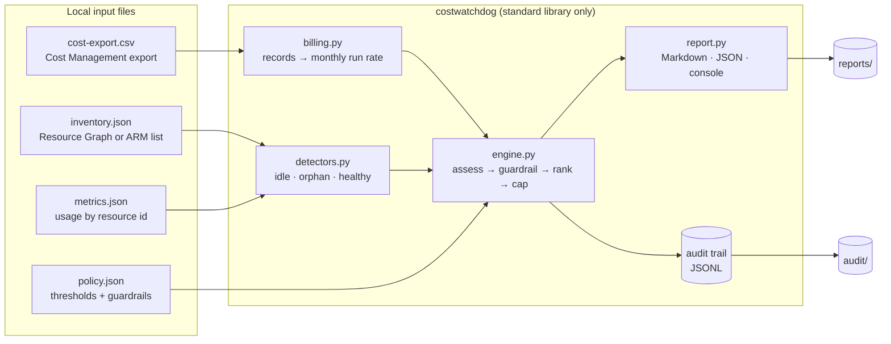

# azure-cost-watchdog

**Find idle and orphaned Azure resources from your cost exports and inventory, and price the waste per resource. Everything runs offline.**

Feed it a Cost Management CSV, a resource inventory, and usage metrics. It reads those files and writes a report. It has no Azure SDK, no credentials, and no network calls, so it cannot change anything in your subscription. Every recommendation carries its own evidence, so you can read one entry and see which numbers and which rule produced it.

```text
monthly run rate        USD 886.80
identified waste        USD 512.78
passing guardrails      USD 183.18
pending approval        USD 189.34
resources considered    14 (4 healthy, 1 below threshold)
```

Of the USD 512.78 identified, USD 183.18 passes every guardrail and USD 189.34 needs a human decision first (`environment=prod`). The remaining USD 140.26 is flagged but held back: two idle VMs, one with the `costwatchdog:protected` tag and one in a denylisted scope.

## Quick start

```bash
pip install -e .
costwatchdog audit \
  --cost-csv examples/cost-export.csv \
  --inventory examples/inventory.json \
  --metrics examples/metrics.json \
  --policy examples/policy.json \
  --format both
```

- **Reports:** Markdown and JSON, written to `reports/` by default.
- **Audit trail:** a JSONL record of each run in `audit/` (turn it off with `--no-audit-log`).
- **CI gate:** `--fail-on-waste 1000` exits with code 3 when identified monthly waste goes over the amount.
- **Dependencies:** Python 3.10+ and the standard library, nothing else.

## What it will and won't tell you

- **Recommendations only.** The report says things like "review whether this VM can be deallocated". It never emits cloud commands, and there is no `apply` command.
- **Guardrails decide the section.** Protected tags, denylisted resource groups, missing owner or environment tags, and `environment=prod` move a finding from "passing guardrails" to "pending approval" or "notify only".
- **Orphan recommendations are opt-in.** `allow_orphan_deletion: true` in the policy file is what makes the report include `delete-orphan` recommendations. Treat them as a prompt to investigate. Check ownership, dependencies, retention, and backups before anyone acts.
- **No telemetry, no guess.** An expensive resource with no metrics row is reported as unclassified, not assumed idle.

## Architecture


